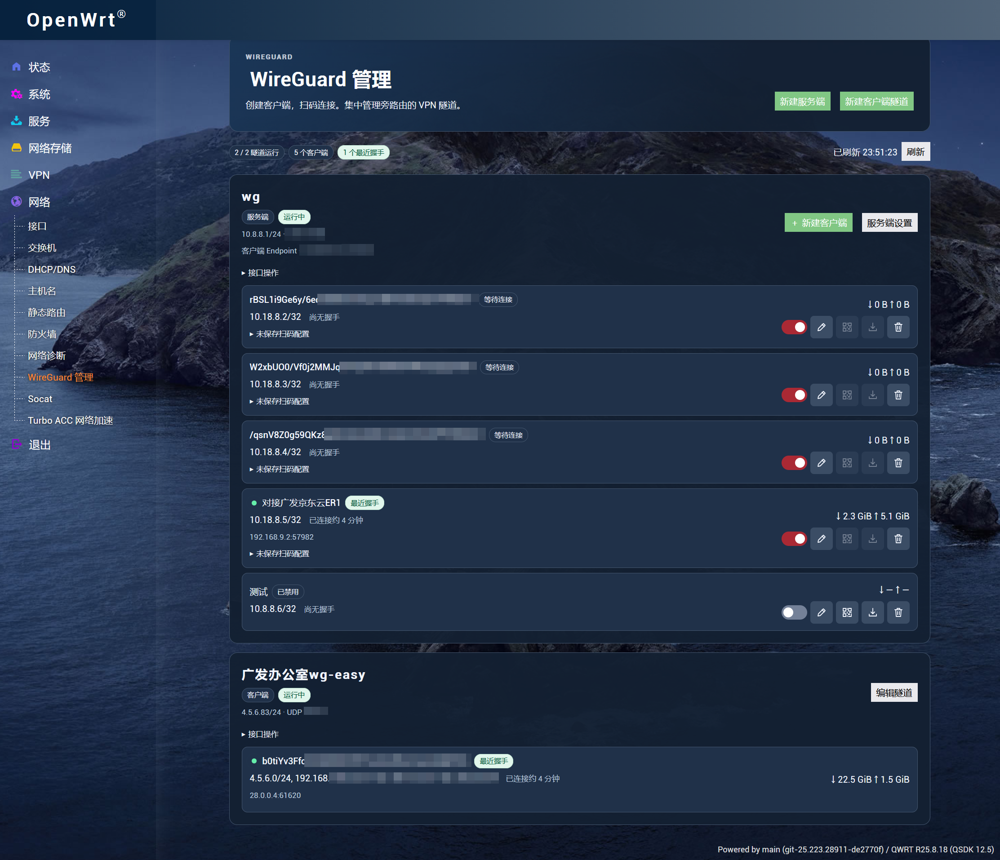

# WireGuard 管理 · LuCI

在 OpenWrt 系路由器的 LuCI 中管理 WireGuard 服务端、客户端和远端隧道。创建客户端后可扫码导入，也可下载 `.conf`。



## 兼容性

安装包使用 `opkg`，依赖 Lua 版 LuCI 或 LuCI 的 Lua 兼容运行时，以及固件对应的 WireGuard 组件。已在京东云 ER2（QWRT 21.02-SNAPSHOT，QSDK 12.5）使用，并在京东云 ER1（ImmortalWrt SNAPSHOT）验证安装和 LuCI 页面加载。

## 安装与入口

从 [GitHub Releases](https://github.com/Icodezhan/luci-app-wireguard-manager/releases/latest) 下载 `.ipk`。在 LuCI 的 **系统 → 软件包** 上传安装包，或将它上传到路由器的 `/tmp` 后通过 SSH 安装。

```sh
opkg install /tmp/luci-app-wireguard-manager_1.3.1-1_all.ipk
```

刷新 LuCI 后进入 **网络 → WireGuard 管理**。也可以直接打开 `/cgi-bin/luci/admin/network/wireguard_manager`。页面和 API 要求 root 登录，API 通过 LuCI 校验 POST 请求和会话令牌。

## 服务端

选择已有服务端或新建接口。新接口至少需要一个可分配的 IPv4 或 IPv6 网段以及 UDP 监听端口。保存后按需启动，再添加客户端。插件从接口首个可用的 IPv4、IPv6 网段各分配一个地址，避开接口地址、已配置的 Peer 和内核运行中的 Peer。双栈服务端会为每个客户端同时分配两个地址。

点 **新建客户端**，只填名称即可生成密钥、分配地址和显示二维码。在手机 WireGuard App 中点 **＋ → 扫描二维码**，扫码后给隧道命名并保存。二维码包含与 `.conf` 相同的完整配置。

Endpoint 默认使用路由器 LAN 地址和服务端监听端口。需要从公网连接时，在 **服务端设置** 中填写公网域名和端口。若 WireGuard 路由器位于主路由后，在主路由配置相应的 UDP 端口映射。扫码和下载始终使用最新的 Endpoint、AllowedIPs、DNS 和保活间隔。AllowedIPs 留空时仅路由 WireGuard 接口的网段。需要访问其他 LAN 网段时，请加入对应网段，并在防火墙和上游路由中配置所需转发。

点客户端卡片上的铅笔按钮可编辑名称和 IP。改完 IP 或服务端设置后，请在终端重新扫码或导入新下载的配置。

默认保存新客户端的配置，可从卡片再次扫码或下载。包含私钥的文件保存在路由器 `/etc/wireguard-manager` 中，仅 root 可读，删除客户端时会清理。在 **服务端设置** 中关闭保存后，之后创建的客户端只有在创建弹窗里能扫码或下载。升级前已存在的客户端如果没有可导出的配置，可以新建一个客户端来扫码。

接口、客户端和服务端设置保存在路由器的 `/etc/config/network`，保存的客户端私钥也位于持久存储中，正常重启后会保留。接口是否随系统启动由 **接口操作** 中的开机启动设置决定。

IP 旁会显示估算的连接时长，或上次握手距今多久。将鼠标移到时间上可查看确切的握手时间。插件将三分钟内有握手的运行中 Peer 视为活跃，时长从本轮最早观测到的握手算起。已观测到的握手时间可在隧道停止后继续显示，路由器重启后从新握手开始记录。

对带自动路由、固定 Endpoint、保活或预共享密钥的既有 Peer 执行启用、禁用和删除时，会短暂重启所属接口以同步配置。

## 客户端

选择 **新建客户端隧道**，手动填写参数或上传、粘贴 WireGuard `.conf`。支持单个 `[Interface]` 和单个 `[Peer]`，包括 IPv4/IPv6 地址、Endpoint、AllowedIPs、DNS、MTU、预共享密钥和保活。可创建多个独立隧道。导入时仅接受所列配置字段，`PostUp`、`PostDown`、`Table` 等 wg-quick 扩展会被拒绝。

在 **编辑隧道** 中可以设置显示名称。原系统接口名可在 **接口操作** 中查看。

保存后可启动、停止、编辑，或设为开机启动。启用「为远端 AllowedIPs 安装系统路由」后，netifd 会安装相关路由。旁路由需要使用既有出口时，可以保持此选项关闭并按需配置路由。

## 构建与卸载

在项目根目录运行 `python build_ipk.py`，安装包会生成在 `dist/`。运行 `opkg remove luci-app-wireguard-manager` 可移除管理界面。WireGuard 隧道由系统原生 UCI 管理，卸载后仍可在 LuCI 的 **网络 → 接口** 查看。

浏览器内二维码使用 [Project Nayuki QR Code generator v1.8.0](https://github.com/nayuki/QR-Code-generator/tree/v1.8.0/typescript-javascript)，许可证随源码分发。
